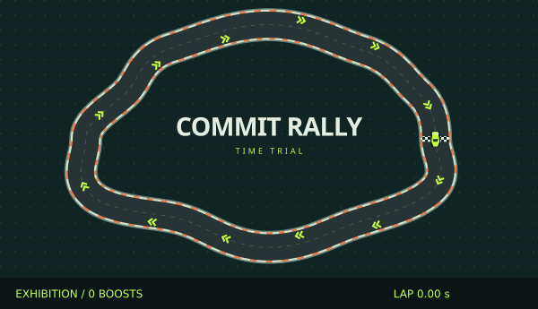

# Commit Rally 🏁

Turn a year of GitHub contributions into a rally circuit. Pick a lane, catch the lime boost arrows, and send a friend a link to race your fastest lap.

**[Play Commit Rally](https://unique50101.github.io/commit-rally/)** · [Set up your own circuit](#publish-your-own-circuit) · [GitHub Action](https://github.com/marketplace/actions/commit-rally)

[](https://unique50101.github.io/commit-rally/)

*Accelerated replay from the game engine on the exhibition circuit. Select the GIF to drive the live circuit.*

## Play a lap

1. Select **Start lap**. The car accelerates automatically.
2. Use **← outer**, **↓ middle**, or **→ inner** to change lanes. On a phone, tap the lane buttons. Line up with the lime chevrons before you reach each gate.
3. Cross the checkered line. **Share fastest lap** copies a challenge URL. Anyone opening it gets the same circuit and a cyan ghost that repeats your steering. Their finish screen shows the time difference.

Your personal best stays in your browser for each circuit. The share link contains the circuit and the recorded steering inputs, so an old challenge still works after the track refreshes. No player account or leaderboard service is required.

## How contributions shape the circuit

The Action reads an individual user's GitHub contribution calendar and groups its weeks into twelve consecutive sectors. A busier sector makes a wider bend. Each sector also determines the lane for one boost gate. Empty calendars generate a driveable oval. The public demo uses the maintainer’s calendar and refreshes weekly.

## Publish your own circuit

In a repository where you can enable GitHub Pages, select **Settings → Pages → Build and deployment → Source → GitHub Actions**. Save the following as `.github/workflows/rally.yml`. Replace `octocat` with your GitHub username, then run **Publish my rally → Run workflow** from the Actions tab.

```yaml
name: Publish my rally
on:
  workflow_dispatch:
  schedule:
    - cron: '17 4 * * 1'

permissions: {}
concurrency:
  group: rally-pages
  cancel-in-progress: false

jobs:
  build:
    runs-on: ubuntu-latest
    permissions:
      contents: read
    steps:
      - uses: Unique50101/commit-rally@v1.0.0
        with:
          username: octocat
      - uses: actions/upload-pages-artifact@v3
        with:
          path: rally-site

  deploy:
    needs: build
    runs-on: ubuntu-latest
    permissions:
      pages: write
      id-token: write
    environment:
      name: github-pages
      url: ${{ steps.pages.outputs.page_url }}
    steps:
      - id: pages
        uses: actions/deploy-pages@v4
```

This workflow publishes the game as the repository's Pages site. If that repository already hosts a website, use a separate repository or include the generated game directory in your existing site deployment.

### Add the track to your profile README

Replace both example URLs with your deployed Pages address. To challenge visitors to your personal best, replace the **second** URL with your copied ghost link.

```markdown
[](https://YOUR-NAME.github.io/YOUR-REPO/)
```

### Action inputs and output

| Input | Default | Purpose |
| --- | --- | --- |
| `username` | Repository owner | Individual GitHub login used to generate the track. Organization-owned repositories must supply a user login. |
| `token` | Built-in GitHub token | Reads the contribution calendar during the build. |
| `output-dir` | `rally-site` | New subdirectory for the game, track data, and README preview. |

The `directory` output contains the generated site's workspace-relative path. The static files run without a token. Use a clean output directory for each build.

## Run locally

With Python 3 installed, run `python -m http.server 8000 --directory docs` and open **http://localhost:8000** for the included exhibition circuit. Run `node --test` with Node.js 22 or newer to check track generation and replay integrity.
